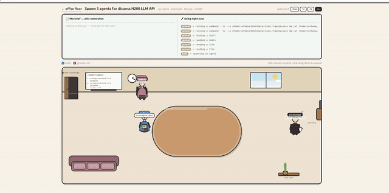

# open-office

**Agent Office** — a local, cartoon office that watches [OpenCode](https://opencode.ai)
agents and sub-agents work. One root session is a desk pod in an open-plan floor;
open a pod and every agent/sub-agent session becomes a person at the table with a
speech bubble, a whiteboard of what is in flight, and a couch for the idle ones.



*One meeting room: agents walk in through the door, take seats, and report what
they're doing on the whiteboard.*

Zero dependencies. One Node file, three static files.

## Requirements

- Node **>= 22.5** (uses the built-in `node:sqlite`)
- An OpenCode data directory containing `opencode.db`

## Run

```bash
node server.mjs
# → Agent Office  →  http://127.0.0.1:7777
```

Options:

| Flag     | Env var         | Default                                  |
| -------- | --------------- | ---------------------------------------- |
| `--port` | `PORT`          | `7777` (bound to `127.0.0.1` only)        |
| `--db`   | `OPENCODE_DB`   | `~/.local/share/opencode/opencode.db`    |

```bash
node server.mjs --port 8080 --db /path/to/opencode.db
```

The database is opened **read-only**. The OpenCode HTTP API is Basic-auth
protected and deliberately not used, so no credentials are needed. The UI polls
the JSON API every ~2.2s; see [NOTES.md](NOTES.md) for the WebSocket plan.

## What you get

- **Office floor** (`/`) — all recent root sessions as desk pods on one shared
  stage. Live sub-agents walk in through the door, work, and file out; rooms
  that go quiet are evicted.
- **Meeting room** (`#/room/<id>`) — animated seats, status from the message log
  (typing, hammering, thinking, napping), walk speed 0.5×–3×, click anyone to
  peek at their dossier.
- **Whiteboard** — the room's todo board plus a live "doing right now" feed,
  from tool calls humanized into plain verbs (`editing a file · server.mjs`).

### HTTP API

| Endpoint             | Purpose                                             |
| -------------------- | --------------------------------------------------- |
| `GET /api/sessions`  | Room cards / pods (`?window=all\|live`)             |
| `GET /api/room/:id`  | One room: seats, board, live agents                 |
| `GET /api/live`      | "Meeting rooms in use" strip                        |

Anything else is served from `web/`.

## Layout

| File            | What's in it                                              |
| --------------- | --------------------------------------------------------- |
| `server.mjs`    | DB queries, JSON API, static server, activity inference   |
| `web/app.js`    | Floor + room rendering, walking simulation, rAF loop      |
| `web/style.css` | Office art and keyframe animations                        |
| `web/index.html`| Shell markup for both views                               |
| `NOTES.md`      | Design history (v2 stage → v4 open-plan), data-model notes, TODO |

## Tuning

Windows (`ACTIVE_WINDOW`, `BUSY`, `DONE_LINGER`, the 4-hour living window) are
literals near their query in `server.mjs`; animation constants — slots, routing,
walk speed — live in the `SIM` section of `web/app.js`.

## Status / known limits

- Active-vs-idle is a heuristic from the newest assistant message's tool status;
  a room with no writes for ~3 minutes counts as resting.
- Big rooms hide retired sub-agents past 24 seats.
- Full redraw per poll — no deltas yet (that's the WebSocket TODO).

Local toy: it reads your own session history on `127.0.0.1` and nothing else.

## Demo GIF

The GIF above is the only committed recording; raw `.mp4` screen captures in
`asset/` are gitignored. To re-render it after changing the UI:

```bash
ffmpeg -ss 34 -t 15 -i recording.mp4 -an \
  -vf "crop=1240:614:24:106,fps=10,scale=640:-1:flags=lanczos,\
split[s0][s1];[s0]palettegen=max_colors=128:stats_mode=diff[p];[s1][p]paletteuse=dither=bayer:bayer_scale=5:diff_mode=rectangle" \
  asset/demo.gif
```

The clip keeps the liviest 15 s of the recording (agents arriving and seating).
The crop drops the browser/desktop chrome, `fps=10` keeps walking smooth at
~600 KB, and the palette pass keeps the speech-bubble text legible.
